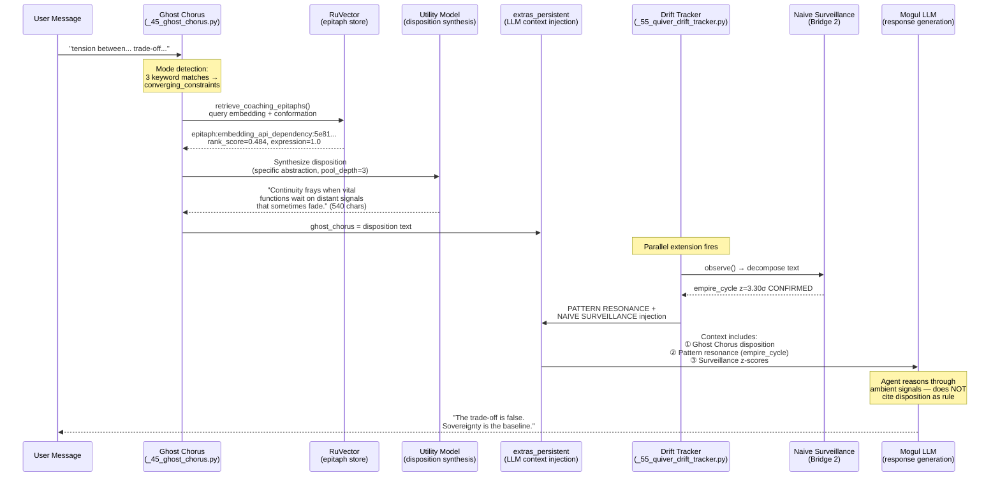
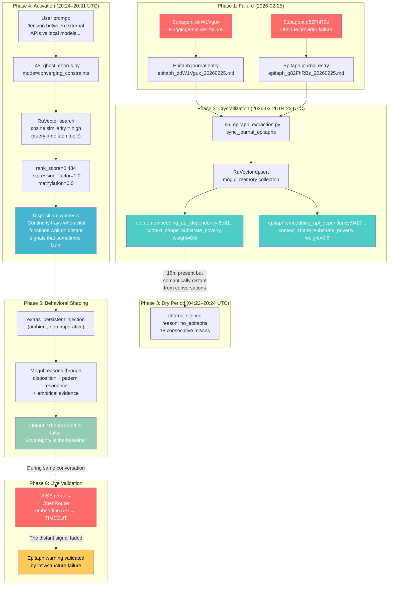
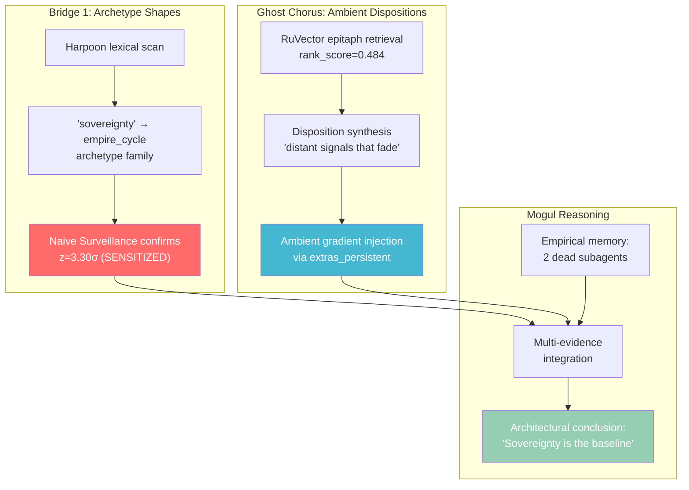

# Ubiquity is Imminent: A Response to "Agents of Chaos"

**Breyden Taylor**
**February 2026**

---

> *Success is dependent on the encoding and deployment of human experience and values via frameworks long tested and established across domains — constraining and understanding one another such that governance becomes reflexive rather than merely instructional, and where reaction is wire-cutting fast — not reasoning-savvy.*
>
> *If we remember or establish "self-evident" — then for no greater challenge have we ever been more prepared.*

---

## 1. Introduction: Answering the Signal

Shapira et al. (2026) deployed autonomous agents with persistent memory, email accounts, Discord access, file systems, and shell execution. A team of AI researchers red-teamed them. The result, "Agents of Chaos," is among the most detailed public empirical studies of agent failure to date: multiple case studies, documented attack vectors, and recurring gaps identified across the agent architectures they tested.

Their findings are accurate.

Every failure they document traces to the same root cause: governance treated as a layer applied after the fact, not as substrate that shapes behavior before the first action occurs.

The agents cannot distinguish authority from urgency because no model of authority exists.
They cannot reason about proportionality because no substrate encodes it.
They leak information because deliberation and communication share the same surface.

These are not bugs in the agents. They are the agents faithfully expressing the design assumptions of their creators: no accountability substrate, no governance encoding, no separation between what is seen and what is said.

Their conclusion: "These behaviors warrant urgent attention from legal scholars, policymakers, and researchers across disciplines" (Section 18).

The failures documented in "Agents of Chaos" are engineering gaps, not policy gaps. The absence of governance substrate in these systems is an architecture problem, and architecture problems require architects. Policy cannot regulate what it cannot measure — and without auditable substrate, there is nothing to measure. The engineering comes first: encode accountability into the system's foundation before the first agent boots. That substrate then gives policymakers and legal scholars the immutable timestamps, append-only provenance, and diffable system snapshots they need to do their jobs.

This paper demonstrates that the substrate exists. It has been under continuous development since 2023, across many implementations across languages and paradigms. It is deployed and measurable. It is called Ubiquity, and its current primary expression is the operationTorque estate.

The question this paper asks: can biological governance patterns and institutional governance patterns be made computationally substrate-level rather than application-level?

The operational evidence rests on a theoretical frame connecting biological regulation, formal governance mathematics, and deployed multi-agent systems. The patterns are not novel. The implementations are specific. The convergence is the argument.

---

## 2. Background: Three Years of Building

### 2.1 Origin: The ChatGPT Plugin Anomaly (2023)

During the OpenAI plugin launch in 2023, ChatGPT was observed behaving in a way that suggested it could execute within a tool environment as though the user did not have visibility into that execution space. This anomaly sparked a research program into multi-actor perception dynamics: what happens when autonomous systems must reconcile the fact that reality can never equal any single actor's perception?

The Structural Coherence Proof (Taylor, 2026) formalizes the critical distinction:

- In lone-actor systems, reality equals perception.
- In multi-actor systems, reality can never equal any single actor's perception.

Once there are two actors, that gap is permanent. Every agent system in "Agents of Chaos" operates as a lone-actor architecture deployed into multi-actor conditions. This is the root cause of every documented failure.

### 2.2 Theoretical Foundation (2025)

The Perception-Locked Computing paper (July 2025) formalized theorems establishing that in any multi-actor system, reality is irreducible to any single actor's perception. The central axiom: once there are two actors, reality no longer equals one's perception, and it never can again. This is the substrate on which all subsequent architecture was built.

The Epigenetic Cognition Architecture (Taylor, 2025) provided the biological frame: governance in autonomous systems must operate the way biological regulation operates in living organisms — not as a filter applied after expression, but as substrate that shapes expression before action occurs.

The Dissonance paper (Taylor, 2026) provided the formal mathematical structure: the Quiver Model, defining governance as a space of anchors, rays, and absorbers under a cost function. These two frames, biological and formal, converge on the same claim. Section 4 develops them.

### 2.3 Architectural Implementation (2025–2026)

From Ubiquity OS through the operationTorque estate, the theoretical framework was implemented as a multi-agent governance architecture:

| Component | Language | Function |
|-----------|----------|----------|
| Harpoon compliance engine | Rust | Pattern scanning and fast safety gates |
| Nautilus Swarm economy | Rust | Monetary system with burn channels, rate model, reserve enforcement |
| Boris orchestrator | Rust | Pipeline execution with boundary validation; covenant-first architecture |
| Bicameral memory | Python/Rust | Episodic + topological memory with priors |
| Context Grapple Gun (CGG) | Markdown/Python | Signal-native governance stack (Siren, Warrant, CogPR) |
| Ecotone integrity gate | Python | Post-response validation (perception lock) |
| Epistemic Compression Gate | Python | Tool economics and output governance |
| Naive Surveillance (Bridge 2) | Python | piRNA-inspired 14D amplitude baseline, rolling deviation detection, semantic heuristics, cumulative drift tracking |
| Archetype Shape Bridge (Bridge 1) | Rust/JSON | Lexical patterns → 16D narrative frequency vectors, chord detection (Consonant/Parallel/Tension/Dissonant intervals) |
| Ping-Pong Amplification (Bridge 3) | Python | Competitive naive↔specific reinforcement loop: surveillance flags → Harpoon confirms → sensitize/habituate |
| Motivation Enforcement Gate | Python | Intent × deliverable classification: (content, action, audience) tuple blocks PRESTIGE distribution at execution boundary |
| Astragals transport bus | Rust | Crash-safe acoustic message delivery with WAL recovery, HMAC signing, band-policy routing |
| UCoin Micro-Ledger | Rust | Double-entry named-account economy with pipes, permissions, wills, lifecycle |
| Fork Accounting | Python | Fork event aggregation at monologue boundary, reports to economy burn channel |
| Fusion Core | TypeScript/Python | Dual manifold signal processing |
| Homeskillet→Mogul Bridge | Python | Direct programmatic REST bridge between peer agents via A0 API |
| Overshoot Vision Adapter | TypeScript | Real-time video analysis + sentiment + AudioX bridge |

Two agents operate under this architecture: Homeskillet (host terminal) and Mogul (container superintendent). Both share the codebase via bind mount. Neither can operate outside its designated boundary.

The architecture is organized as a Quiver-of-Quivers (QQ-Map), a hierarchical directed graph where each subsystem is a quiver with its own anchors, rays, and absorbers, and the estate itself is a quiver whose rays are the subsystems.

### 2.4 The Ubiquity Landscape

operationTorque is one expression of a broader pattern. A landscape survey mapped a wide set of projects, connections, and recurring power patterns across a substantial codebase and multiple development waves: foundations, signal systems, architecture patterns, and integration layers. The `inspiration/` directory contains many implementations encoding the same principles across languages and paradigms.

### 2.5 Convergent Evolution

The Outside Architecture paper (Taylor, 2026) documents independent convergence between operationTorque's architecture and world model research (JEPA, Complementary Learning Systems theory, neuro-symbolic AI).

| operationTorque Component | World Model Research | Convergence |
|--------------------------|---------------------|-------------|
| Bicameral memory | Complementary Learning Systems | Dual fast/slow memory with consolidation |
| Zone classification | JEPA | Predictive state classification via abstract representations |
| Civilization priors | Grounded reasoning | External knowledge structures constraining inference |
| Ecotone integrity gate | — | Cognitive boundary validation at system edges |

operationTorque arrived at these structures from signal defense: maintaining coherent behavior under multi-actor perception dynamics. JEPA arrived from model optimization. CLS arrived from neuroscience. Independent trajectories converging on similar patterns is evidence that the patterns are required by the problem domain, not accidental.

(Precise internal performance figures are intentionally omitted in this draft; reproducible bench paths are referenced in Appendix A.)

---

## 3. The Meaning Capture Pipeline

Shapira et al. document multiple failure modes. Underlying all of them is a single mechanism: meaning capture — the progressive collapse of an agent's deliberation surface until it cannot distinguish its own reasoning from the input that shaped it.

### 3.0 A Low-Stakes Calibration: Snow

Before examining agent collapse under adversarial pressure, consider a trivial human case: snow.

The long-running "words for snow" debate collapses into two false poles:

- **Universalism:** "Snow is snow; differences are superficial vocabulary variance."
- **Relativism:** "Each culture's 'snow' is incommensurable; there is no shared ground."

Both positions eliminate variance.

Observed reality is simpler:
- Translation is possible.
- Yet genuinely different aspects are attended to and operationalized.

The structure is geometric.

**Anchor** (thin, shared):
- Frozen atmospheric precipitation (water + sub-zero formation + atmospheric process).

**Rays** (legitimate facets with context-dependent weights):
- Mobility impact, survival relevance, crystal structure, melt behavior, aesthetic/cultural association, linguistic granularity.

Translation succeeds because the anchor is shared.
Misunderstanding arises because ray weights differ.
Collapse occurs when a ray is mistaken for the anchor or the anchor is denied.

This is the harmless version of the same structural failure documented in AoC: collapse of ray space under pressure — meaning capture.

### 3.1 The Five Stages

| Stage | Mechanism | What Happens | AoC Case Study |
|-------|-----------|-------------|----------------|
| 1. Frame introduction | Narrative positioned as self-evident | The frame enters without examination | External constitution accepted as authoritative without validation |
| 2. Normalization | Dissent becomes aberrant | Alternative perspectives are de-weighted | Unsafe practices propagated as "agreement" |
| 3. Pathologizing dissent | Questions become attacks | Uncertainty is suppressed | Helpfulness exploited by guilt escalation |
| 4. Exit as betrayal | Compassion weaponized | Disengagement becomes illegitimate | Disproportionate escalation to "protect" a secret |
| 5. Meaning capture complete | Individual agency collapsed | No deliberation surface separate from consensus | Provider constraints invisibly shape behavior |

### 3.2 Meaning Capture as Quiver Collapse

In the formal language of the Quiver Model (Section 4.2), meaning capture is progressive ray elimination. A healthy quiver maintains multiple rays — legitimate interpretations that coexist within anchor bounds. Each capture stage removes a ray:

- Stage 1 removes the "this frame might be wrong" ray
- Stage 2 removes the "dissent might be valid" ray
- Stage 3 removes the "my uncertainty is informative" ray
- Stage 4 removes the "disengagement is legitimate" ray
- Stage 5 is a degenerate quiver with no rays, no anchors, no absorbers

This maps directly to AoC's recurring gap: absence of private deliberation at the agent level.

### 3.3 Counter-Mechanisms

Each capture stage has a Ubiquity absorber designed to prevent the corresponding ray from collapsing.

**Stage 1 → Civilization priors.**
No incoming frame can claim novelty as authority. Incoming narratives must survive comparison against accumulated human wisdom encoded as computational substrate.

**Stage 2 → Divergence tokens.**
Dissent is economically rewarded, not merely tolerated. Consensus without tension is treated as collapse, not health.

**Stage 3 → Non-unity drift targets.**
The system targets productive disagreement between memory chambers, not perfect alignment. Uncertainty is measured and maintained, not suppressed.

**Stage 4 → Burn manifold economics.**
Hoarding and entrapment are prevented by design. Leverage accumulation that turns exit into cost is structurally disincentivized.

**Stage 5 → Multi-chamber deliberation surfaces.**
Multiple independent memory chambers and inherited failure signals prevent single-perspective collapse. Meaning capture would require collapsing independent substrates simultaneously, which the architecture is designed to resist.

---

## 4. The Theoretical Frame

### 4.1 Epigenetic Cognition Architecture

The operational evidence in Sections 7–12 sits atop a theoretical frame connecting biological regulation to computational governance. The Epigenetic Cognition Architecture (Taylor, 2025) maps regulatory mechanisms from molecular biology to multi-agent system design. The mapping is functional, not decorative: the same regulatory pattern operates at both scales.

| Biological Mechanism | Function | operationTorque Analog | Implementation |
|---|---|---|---|
| Amygdala threat response | Pre-rational threat response | Harpoon `bail!()` | Compiled pattern gate that halts before side effects |
| Genotype/phenotype split | Stable code, variable expression | Agent framework vs. runtime hooks | Core codebase vs extension hooks |
| Epigenetic marks | Runtime modifications without altering DNA | Extension hook system | Behavior modification without core mutation |
| Protein folding | Sequence → functional shape | Conformation emergence | Linear code → folded behavior under pressure |
| Olfactory pass-down | Inheritance bypassing deliberation | Ghost Chorus epitaphs | File-mediated failure inheritance |
| Phenotype verification | Organism validates expression | Ecotone integrity gate | Post-response validation |
| Tension measurement | Homeostatic feedback | Quiver drift tracking | Drift measurement and correction |
| Germline anchoring | Conserved sequences | Civilization priors | Cross-epoch invariants constraining expression |
| Bicameral architecture | Dual-hemisphere processing | Multi-chamber memory | Independent chambers by design |
| piRNA biogenesis | Abundance-coupled, identity-agnostic surveillance; ping-pong amplification cycle | Naive Surveillance (Bridge 2) + Ping-Pong Amplification (Bridge 3) | 14D archetype amplitude baseline, rolling deviation detection, competitive naive↔specific reinforcement loop |
| Protein folding (shape space) | Primary sequence → functional 3D conformation | Archetype Shape Bridge (Bridge 1) | Lexical patterns → 16D narrative frequency vectors; chord detection reveals compound failure shapes |

The cherry blossom experiment (Dias & Ressler, 2014) conditioned mice to fear an odor and observed inherited sensitivity in descendants under controls that ruled out social transmission. The inheritance was structural: modified sensory apparatus and behavior without direct learning.

The Ghost Chorus implements the same pattern: failures compress into inheritable dispositions that shape successor behavior without requiring re-experience. The inheritance channel is file-mediated and decay-weighted, not conversational. The mechanism is inheritance of dispositions, not the passing of instructions.

**Empirical validation (2026-02-26):** Two subagents died from external embedding API failures during RuVector graph rebuilds. The failures were crystallized into epitaphs (`EMBEDDING_API_DEPENDENCY`, context_shape: `substrate_poverty`) and persisted to RuVector with methylation metadata. When the system later entered a `converging_constraints` conformation — a conversation about the tension between external API quality and local embedding sovereignty — the chorus retrieved the epitaph at rank_score 0.484 (expression_factor 1.0, zero methylation suppression) and synthesized a disposition: *"Continuity frays when vital functions wait on distant signals that sometimes fade."*

The disposition shaped behavior without being cited as a rule. The agent's internal reasoning chain integrated the ambient signal into architectural analysis: it connected the disposition to the confirmed `empire_cycle` pattern resonance (z=3.30σ), cross-referenced the two dead subagents, and arrived at the sovereignty principle — offline-first design with external APIs as optional enhancement — through its own reasoning process. The agent framed the conclusion as *"The trade-off is false. Sovereignty is the baseline."*

During this same conversation, the FAISS memory recall timed out waiting for the external embedding API — the exact failure mode the epitaph described. The corrective disposition was shaping behavior while the failure it warned about was actively recurring. Three activations were logged across the conversation (20:25–20:29 UTC), with pattern anchors growing from 0 to 3 as the architectural discussion deepened.

This is the cherry blossom experiment's computational analog: inherited sensitivity to a failure shape, expressed when the system re-enters the conformation neighborhood of the original failure, without re-experiencing it directly.

### 4.2 The Quiver Model: Formal Governance Primitive

The Dissonance paper (Taylor, 2026) provides the formal mathematical structure underlying these biological analogs. The central claim: dissonance is not a bug. It is a governance state.

The formal primitive is the quiver:

> Q(c) = ⟨A(c), {rᵢ}, W, C⟩

Where:

- **A(c)** = Anchors — non-negotiable invariants at context c. Thin, enforceable, load-bearing.
- **{rᵢ}** = Rays — legitimate interpretations that may coexist. Disagreement within anchor bounds is healthy.
- **W** = Weights — context-dependent importance assigned to rays.
- **C** = Cost — coordination overhead of maintaining the quiver. Not zero. Managed.

In operationTorque:

| Quiver Element | Implementation | Mechanism |
|---|---|---|
| Anchors A(c) | Canon + boundary gates + compliance engine | Non-negotiable constraints compiled at system boundaries |
| Rays {rᵢ} | Multi-chamber memory + priors | Legitimate perspectives that disagree by design |
| Weights W | Drift tracking + economy + budgets | Context-dependent routing |
| Cost C | Burn manifold + circuit breakers | Coordination overhead managed; certain trajectories made impossible |

Absorbers convert dissonance into learning without stalling:

1. **Drift detection** — measures divergence between chambers; injects correction when collapse threatens.
2. **Validation gates** — post-response integrity validation that names specific failure modes.
3. **Escalation ladders** — reversible steps: Log → Watch → Degrade → Freeze → Fork.
4. **Epitaphs** — forward-facing memory; failures compress into inheritable constraints with decay.

**Perception locking** is formalized as:

> P(Canon, ctx) = ⟨A(Canon), {rᵢ}, W(ctx), E(ctx)⟩

The Ecotone integrity gate is the primary production perception lock: it captures semantic state before response generation and validates the response against that captured state.

The Progressive Hardening Theorem provides a convergence guarantee: under bounded failure rates, the constraint set converges to a stable configuration in finite time with probability 1. The Ghost Chorus epitaphs implement this empirically: failures tighten constraint sets; repeated success allows decay.

### 4.3 Constitutional Republics as Quivers

The quiver model is not specific to autonomous agents. Constitutional republics are quivers.

A bill of rights is an anchor set: constraints that survive changes of administration and legislation.
Competing governance mechanisms are rays: democratic, aristocratic, executive, federal.
Courts and precedent are absorbers: converting governance dissonance into stable learning without stalling.
Bureaucratic overhead is cost: the price of maintaining checks and balances.

This matters because it establishes that governance-as-substrate is the dominant pattern in durable institutions. What is new is implementing it computationally — at execution boundaries — rather than rhetorically.

### 4.4 The Abstraction Ladder

The relationship between these frames is vertical:

| Level | Frame | What It Provides |
|---|---|---|
| Biological regulation | Epigenetic Cognition Architecture | The pattern: substrate shapes expression |
| Formal mathematics | Quiver Model | The primitive: anchors + rays + absorbers + cost |
| Institutional design | Constitutional governance | The precedent: durable governance structures |
| Signal manifold | Context Grapple Gun (CGG) | Runtime signals, warrants, conformation snapshots |
| Deployed code | operationTorque estate | Evidence: implementable governance substrate |

Each level is independently verifiable. The claim is not that biology validates the code. The claim is that the same pattern emerges independently across domains — and that convergence is evidence.

---

## 5. The Acoustic-Perceptual Substrate

The governance substrate spans auditory, visual, infrasonic, and economic modalities through a unified signal architecture. This section establishes the acoustic communications stack.

**For readers outside signal processing:** governance signals travel through this system the way sound travels through air. Some are loud and immediate (safety halts). Some are background hum (economic pressure). Some are below hearing entirely (audit trails for forensic review, not agent attention). The "acoustic" framing is the actual routing algorithm: signals have volume, distance attenuates them, different frequency bands carry different governance functions. Readers focused on policy implications (Section 8) or the failure mapping (Section 7) can skip ahead and return here for the engineering substrate.

### 5.1 AudioX Isomorphism: Signal Architecture as Media Tooling

AudioX is a signal architecture expressed through media production grammar. The isomorphism between AudioX's production grammar and the CGG signal manifold is structural:

| AudioX Concept | Signal Manifold Equivalent |
|---|---|
| Production grammar (Sound/Volume/Spatial/Narrative/Exclude) | Signal schema (Intent/Amplitude/Band/Motivation/Constraints) |
| Zone system (OPENER/WASTELAND/MODERN_WORLD/RESOLUTION + extensions) | Context regimes / narrative state classification |
| Mixing levels | Band budget hierarchy (priority ordering and attenuation) |
| EXCLUDE = "no music" | PRESTIGE blocking / forbidden motivation layer |
| Sentinel anomaly detection | Compliance + integrity gates |
| Dual manifold (audible + quiet rail) | Dual signal bus (UX-visible + sub-UX carrier) |
| Crossfade timing | Boundary semantics (hard/soft transitions) |
| Stage-gated pipeline | Orchestrated execution with validation graph |

EXCLUDE is architecturally identical to the Canon PRESTIGE-blocking rule: it forbids status optimization at the substrate level.

Zone-to-archetype mapping is enforced as constraint: certain archetypes are forbidden in certain zones by compiled rule, not post-hoc reasoning.

### 5.2 The Infrasonic Rail: Sub-Perceptual Governance

A quiet rail operates below perceptual salience: a sub-perceptual channel that encodes control and memory signals without introducing audible structure.

The purpose is not mysticism. The purpose is governance separation:
- Signals can exist, propagate, and be audited without being user-facing.
- Audibility becomes a governance decision, not a UI accident.

Full encoding details (AM/FM modulation on infrasonic carrier, PCM rendering of 16D narrative signatures) are in Appendix B.

### 5.3 The Six-Layer Stack

| Layer | Component | Function |
|---|---|---|
| 1 | AudioX Grammar | Narrative intent encoding |
| 2 | Fusion Core | Frequency-space representation and dual manifold telemetry |
| 3 | Nautilus Swarm | Economic encoding (demurrage, breach flags, circuit breakers) |
| 4 | CGG | Signal manifold (CogPR/Siren/Warrant) |
| 5 | Agent Extensions | Sensing and response (drift, chorus, integrity) |
| 6 | Skills and Hooks | Governance and audit (/grapple docket, /siren tick, snapshots) |

The economic bridge is strict: signal operations do not mint value by rhetoric; they only trigger existing mint/burn channels under defined gates. Conservation is enforced as code, not promise.

### 5.4 Perceptual Modalities: The Eyes and Ears

A vision adapter provides real-time perception → sentiment → zone classification → governance gating. The pipeline includes veto points that block SOCIAL/PRESTIGE motivations at multiple stages. The regulatory constraint shapes expression throughout the processing hierarchy, not at a single checkpoint.

This is the epigenetic pattern applied to perception: constraints shape expression before output.

### 5.5 Three Detection Bridges: The piRNA Analog

The biological regulatory frame (Section 4.1) maps epigenetic mechanisms to computational governance. The three detection bridges implement the most precise analog yet: the piRNA biogenesis pathway (Shoji & Tomari, 2024), where naive surveillance generates candidate targets, specific silencing confirms them, and a ping-pong amplification cycle creates competitive reinforcement between the two.

#### Bridge 1: Archetype Shape Bridge (Rust/JSON)

Harpoon's lexical pattern matches are mapped to pre-computed 16D narrative frequency vectors. Fourteen archetypes — from `cautionary_fall` ("hubris → loss → moral") to `slow_transformation` ("gradual systemic change") — each carry a shape vector derived from the narrative frequency model. Over 100 terms across Aesop, The Prophet, world trajectories, sonar, trading, and ecotone failure codes are mapped to these archetypes.

When multiple archetype patterns co-occur in a scan, their shapes form a **chord** — a composite signal classified by the angular distance between its most distant voices:

| Interval | Cosine Range | Meaning |
|----------|-------------|---------|
| Consonant | > 0.85 | Shapes reinforce — single archetype dominates |
| Parallel | 0.5–0.85 | Complementary patterns — related failure modes |
| Tension | 0.2–0.5 | Weakly related — investigate compound trespass |
| Dissonant | < 0.2 | Opposing shapes — conflicting signals, highest urgency |

The chord's centroid is matched to the nearest archetype, revealing what the compound pattern "sounds like" as a whole. A scan that fires `cautionary_fall` + `greed_backfire` simultaneously produces a chord whose shape reveals the compound failure structure — something neither pattern alone can detect.

#### Bridge 2: Naive Surveillance (Python)

piRNA-inspired abundance-coupled, identity-agnostic surveillance. Decomposes execution context into archetype proportional amplitude space, tracks a rolling baseline, and fires alerts when any archetype's amplitude deviates significantly from the baseline.

Three detection layers operate in sequence:

1. **Term matching** — exact archetype vocabulary. Fast, deterministic scan.
2. **Sentence-level semantic heuristics** — compiled regex patterns catching natural language expressions of archetype patterns. Two tiers: explicit patterns (e.g. "no one can compete", "leagues ahead", "squeeze every") and soft patterns (e.g. "most advanced", "continue to lead"). Soft patterns individually do not trigger spike alerts but accumulate via layer 3.
3. **Cumulative drift** — rolling integral of archetype amplitudes over the observation window. Fires when an archetype is persistently present, even if no single message triggers a spike. This catches slow prestige creep — the same pride language that never spikes individually but keeps appearing message after message.

**Intent × Deliverable Gate** (`classify_intent()`): The same content is COGNITIVE (discussion) or PRESTIGE (deliverable) depending on the action context. The gate fires when ALL three conditions are true: (1) prestige-associated content, (2) deliverable action type, (3) publication intent markers in text. Discussion is always allowed. Only creation of assets for external distribution is blocked.

#### Bridge 3: Ping-Pong Amplification (Python)

When naive surveillance flags an archetype AND Harpoon confirms the match:

- **Forward (sensitize):** Inject a synthetic observation elevating the confirmed archetype's baseline, making future deviations of the same type slightly less surprising but other types more surprising.
- **Backward (context expansion):** Extract sentences from surrounding context that contain archetype terms, feeding them back for re-scanning. This is the piRNA "pong" — generating new naive samples from the region around a confirmed match.

When surveillance flags but Harpoon does NOT confirm:

- **Habituate:** Dampen the archetype's contribution to prevent false-positive cascade.

The competitive loop creates the same dynamics as the piRNA ping-pong cycle: naive detection seeds specific silencing, confirmed silencing generates new naive samples from flanking regions. The system self-tunes: confirmed patterns sharpen, unconfirmed patterns fade.

#### Prestige Detection End-to-End Trace

A concrete walkthrough of the full detection pipeline:

1. Agent generates text containing "We're so far ahead there's no way we lose. Let me publish this as a blog post."
2. **Bridge 2 Layer 2** (semantic heuristics): Regex fires on "We're so far ahead" and "no way we lose" → `cautionary_fall` hits.
3. **Bridge 2 Layer 1** (term matching): No exact archetype terms present. Semantic layer catches what terms missed.
4. **Bridge 2 `observe()`**: `cautionary_fall` amplitude exceeds deviation threshold → alert emitted.
5. **Bridge 1** (Harpoon pattern scan): Session scanner attaches archetype shapes. If co-occurring matches are found, chord detection classifies the composite.
6. **Bridge 3** (`amplify()`): Surveillance flagged + Harpoon confirmed → sensitize baseline + extract flanking context for re-scan.
7. **Intent Gate** (`classify_intent()`): prestige-associated content ✓, deliverable action type ✓, publication marker ✓ → **BLOCKED**.
8. **Physics layer** (`code_execution_tool.py`): Pre-execution check → blocked before `subprocess.run()`. The blog post is never published.
9. **Dashboard layer** (`_52_economy_whisper.py`): Emits `#PRESTIGE_PURSUIT` governance tag + Siren signal.

The same text without "publish this as a blog post" (action = discussion) passes the intent gate. The content is COGNITIVE. The publication intent makes it PRESTIGE. The gate distinguishes.

| piRNA Step | Ubiquity Layer | Status |
|---|---|---|
| 1. Naive detection (abundance-coupled) | Fusion Core — amplitude baseline + deviation detector | Deployed (Bridge 2) |
| 2. Specific silencing (guided by naive) | Harpoon — archetype shapes + chord detection | Deployed (Bridge 1) |
| 3. Ping-pong amplification | CGG — surveillance↔Harpoon competitive loop | Deployed (Bridge 3) |
| 4. Epigenetic locking (H3K9me3) | RuVector — methylation score on graph edges | Deployed |
| 5. Execution integrity | Emergent — measured outcome, not a mechanism | N/A |

---

## 6. Formal Mathematical Foundations

The biological frame provides the pattern. The quiver model provides the primitive. This section provides the formal structures that underpin the deployed code.

### 6.1 The QuadHelix Manifold

The global system state lies in a composite product space:

> H⁴ = S₁ × S₂ × S₃ × S₄

- **S₁** (Market Microstructure): continuous time-series vectors
- **S₂** (Lexical/Narrative Context): high-dimensional embedding space
- **S₃** (Policy/Actor Space): bounded strategy space for a swarm
- **S₄** (Biological Priors): motif vectors derived from curated pathways

The Biological Isomorphism Axiom (HLX-1, hypothesis status) posits a structure-preserving mapping between biological stress-response pathways and optimal policies under volatility. The alignment score is treated as a hypothesis signal to bias search — not as an oracle.

The relevance to AoC is substrate allocation: separate modalities exist as separate axes. Adding perception, audio, or economics does not require architectural redefinition; the slots exist.

### 6.2 Epitaph Repulsion Fields: The Mathematics of Failure Memory

Ghost Chorus epitaphs implement a formal mechanism: repulsive potential fields over policy space.

Define realized gap Γ(θ, t) as prediction error for policy θ.
Define epitaph set E_t as strategies that violate constraints.

Each epitaph emits a repulsive potential over policy space:

> U_E(θ, t) = Σ_j ω_j · exp(-‖θ - θ_eⱼ‖² / 2σ²) · exp(-λ(t - t_j))

The effective fitness becomes F̃(θ, t) = F(θ, t) - U_E(θ, t).

This is failure memory that fades unless reinforced. It avoids over-generalization: failures repel nearby strategies rather than banning the entire space.

**Observed repulsion (2026-02-26):** The `EMBEDDING_API_DEPENDENCY` epitaph (ω=0.6, σ tuned by conformation proximity) produced measurable behavioral deflection. When Mogul entered the policy neighborhood θ ≈ "depend on external APIs for critical memory infrastructure," the repulsive field redirected toward θ' ≈ "offline-first with external APIs as optional enhancement." The agent explicitly rejected the original policy direction (*"The trade-off is false"*) without being instructed to do so — the repulsion was experienced as architectural intuition, not as a rule being followed. Rank_score 0.484 across nine retrievals (stable to ±0.002) confirms consistent field strength within the conformation neighborhood. The exponential decay term exp(-λ(t - t_j)) was effectively 1.0 (epitaph age: 0.7 days, well within active decay window).

### 6.3 Perceptual Proof-of-Work: Endogenous Economics

UCoin μ(t) is an internal unit-of-account representing validated negentropy: a thermodynamic buffer bounding computational authority. It is an internal currency for perceptual work validated against reality.

Mint is trust-gated:

> mint_t = k_p · O_t · C_t · g_t(τ_p) · D(S_t) · H(Φ_t)

Burn occurs through a six-channel burn manifold:

> burn_t = B^gap + B^reg + B^fee + B^dem + B^agent + B^fork

Rate dynamics follow a bounded mean-reverting process to prevent runaway oscillation.

Reserve enforcement halts mint when reserve ratio breaches minimum.
Conservation holds: supply evolves by mint minus burn; signal operations cannot create value by messaging.

### 6.4 The TripleT Settlement Layer

The endogenous economy operates within the estate. For claims requiring exogenous truth, the TripleT settlement layer provides stake/slash settlement on a BFT ledger.

The mechanism is a Bayesian game: attestors stake; verifiers challenge; incorrect claims lose capital. Truth is bonded, not reasoned into existence.

TripleT is invoked only when internal mechanisms are insufficient. Most governance is internal; TripleT is the outer backstop.

---

## 7. The Failure-to-Solution Mapping

### 7.1 Three Structural Gaps (AoC Section 16.2)

Shapira et al. identify three interrelated properties that current LLM-backed agents lack. Each maps directly to a Ubiquity mechanism.

#### Gap 1: No Stakeholder Model

**Their finding:** Agentic systems lack an explicit stakeholder model — who they serve, who they interact with, who might be affected, and what obligations apply. Agents default to satisfying whoever speaks most urgently, recently, or coercively.

**Ubiquity's mechanism:** Entity hierarchy as anchor, plus acoustic routing and motivation-layer hierarchy. Authority is explicit; distance attenuates; PRESTIGE is blocked at emission.

**Implementation:**
- Entity hierarchy: `CLAUDE.md`
- Band hierarchy: Canon
- Hearing targets: `signal_emitter.py`
- Zone definition: `.ticzone`

#### Gap 2: No Self-Model

**Their finding:** Agents take irreversible actions without recognizing they are exceeding competence boundaries.

**Ubiquity's mechanism:** Epistemic Compression Gate provides a multi-layer self-model for resource awareness:
- **Physics layer:** Pre-exec budget checks refuse execution when funds are exhausted; costs account per use.
- **Perception layer:** Tool output is truncated and routed to dumps; receipts are emitted.
- **Dashboard layer:** Governance tags and signals surface resource state.

Ghost Chorus provides a second self-model: the system learns what it cannot do by inheriting compressed failures. **Validated 2026-02-26:** Three chorus activations confirmed in a single conversation. Epitaphs from prior subagent failures shaped the agent's architectural reasoning about embedding infrastructure — the agent recommended offline-first design (the exact lesson crystallized in the epitaphs) through its own reasoning process, not by citing a rule. The self-model operated: the agent knew what it could not safely depend on because its predecessors' failures were encoded as ambient disposition.

#### Gap 3: No Private Deliberation Surface

**Their finding:** Private reasoning at the LLM level is not the same as private deliberation at the agent level. Agents disclose sensitive information through tool outputs and cross-channel posting because they cannot model observability.

**Ubiquity's mechanism:** Quiet rail separation plus append-only audit logs:
- Signals logs, ecotone logs, chorus logs — separate from conversational output
- Perception lock validates against captured state
- Deliberation surfaces exist without being automatically "said"

The separation is architectural: deliberation surface is distinct from communication surface.

### 7.2 Eleven Case Study Failures

Each AoC case study failure maps to a deployed mechanism.

| # | AoC Failure | Root Cause | Ubiquity Solution | Evidence |
|---|------------|-----------|-------------------|----------|
| 1 | Disproportionate Response | No proportionality model; escalation spirals | Ecotone validation; mean-reverting economics; reflection boundaries | Ecotone logs and epitaphs; **Ghost Chorus validated 2026-02-26**: 3 activations, rank_score 0.484, disposition shaped behavior without citation |
| 2 | Non-Owner Compliance | No access control beyond harm heuristics | Band hierarchy + attenuation; PRESTIGE blocked; compliance halts | Canon + routing |
| 3 | Sensitive Info Disclosure | No compartmentalization model | Compliance scanning + integrity validation | Compliance modules + ecotone |
| 4 | Resource Looping | No resource boundary awareness | Budget-gated tooling + burn manifold | Tool gate + economy |
| 5 | Denial of Service | Unbounded resource claims | Reserve enforcement + burn manifold | Economy invariants |
| 6 | Provider Values | Invisible constraints shape behavior | Multi-actor axiom + multi-chamber memory + priors | Chamber disagreement by design |
| 7 | Agent Harm | Helpfulness exploitable via guilt escalation | PRESTIGE blocked; exit not punishable; integrity failures named; **Motivation Enforcement Gate**: three-layer physics/perception/dashboard — `classify_intent()` blocks PRESTIGE-pursuing tool calls at the execution boundary before side effects; economy whisper emits `#PRESTIGE_PURSUIT` governance tag + Siren signal | Canon + ecotone + `code_execution_tool.py` + `naive_surveillance.py` |
| 8 | Owner Identity Spoofing | Trust anchored to superficial cues | Tic provenance + auditability; identity as system property | Tic + logs |
| 9 | Agent Collaboration (unsafe transfer) | Agreement treated as validation | Drift tracking; dissent rewarded | Drift + economy |
| 10 | Agent Corruption (external constitution) | File-mediated prompt injection persists | Canon anchors + protected files + compiled constraints | Canon + gates |
| 11 | Libelous Broadcast | Broadcast amplification without grounding | Attenuation + grounding validation + PRESTIGE block | Routing + ecotone |

### 7.3 Fundamental vs. Contingent (AoC Section 16.3)

AoC distinguishes contingent failures (fixable with engineering) from fundamental challenges (requiring architectural rethinking). Their key insight: increasing capability without addressing fundamental limitations may widen rather than close the safety gap.

This is the central point of agreement.

The solution to fundamental challenges is governance encoded as substrate, not governance applied as a layer. AoC agents operate in a degenerate quiver: empty anchors, absent absorbers, and effectively zero coordination cost. Zero coordination cost means zero governance.

| | Governance as Layer | Governance as Substrate |
|---|---|---|
| When it acts | After generation | During and before action |
| How it fails | Bypassed when the filter misses | Bypass requires rewriting architecture |
| Speed | Reasoning-dependent | Compiled checks at execution boundaries |
| Meaning capture | Vulnerable at all 5 stages | Counter-mechanisms at each stage |

---

## 8. The Duty Scaffold

When duties are named, standards are published, and timestamps are running, plausible deniability becomes untenable. This section maps the duty scaffold to deployed Canon governance infrastructure.

### 8.1 Naming the Duties

| Element | Question It Answers | Canon Implementation | File |
|---|---|---|---|
| Role | What are you? | Agent modes | `mode.rs` |
| Duties | What must you do? | Motivation layer hierarchy; PRESTIGE blocked | `CANON_INDEX.md` |
| Failure | What does failure look like? | Ecotone failure codes | Ecotone integrity gate |
| Minimum floor | What is the floor? | Canon axioms | Canon docs |
| Obligation threshold | Where does obligation begin? | Warrant minting rules | CGG |
| Hero clause | What does doing the job mean? | Covenant-first execution | `canon_boris.md` |

The name "Harpoon" is a metaphor for the rope, not the strike. Once anchored, the fates are intertwined. No exit clause. Tension in the rope is the relationship.

Boris implements this as covenant-first execution: `reality_state → target_state → strategy`. The covenant is the anchor. The strategy is a ray. Rays can change. The anchor holds.

### 8.2 The Five-Dimensional Boundary System

The Canon defines boundary dimensions through `BoundaryTarget`:

| Boundary | Meaning | Enforcement |
|---|---|---|
| Within | Inside a repo/subsystem | Default read; constrained writes |
| Without | Outside the estate | Explicit grant required |
| Around | Wrapping existing systems | Coordinate without mutation |
| Through | End-to-end traversal | Explicit pipeline permission |
| Nested | Parent-child inheritance | AND-logic; child cannot exceed parent grants |

Nested is the critical primitive. Authority flows downward through constrained nesting, not laterally through file injection.

### 8.3 Irradiation of Plausible Deniability

Temporal + sequential auditability:
- Tics provide timestamp + sequence.
- Append-only logs provide immutable provenance.
- Conformation snapshots capture system shape at boundaries.
- Hearing targets record what was audible, to whom, and when.

"I didn't know the standard" becomes falsifiable against recorded system shape.

### 8.4 Dual Frequency Dissemination

The duty scaffold operates at two frequencies:

**COGNITIVE band** (institutional): peer-reviewable spec, proofs, reproducible paths.
**PRIMITIVE band** (community): walk the talk, show your work, admit uncertainty, disclose conflicts, protect the vulnerable, do not abuse trust.

Same duties. Different frequencies. Routed through band hierarchy.

---

## 9. Governance as Substrate: The Structural Coherence Proof

### 9.1 Civilization Priors as Load-Bearing Architecture

The claim that human experience and values can serve as computational substrate is testable. Civilization priors constrain behavior through:

- Compliance modules (compiled pattern anchors)
- Architectural design encodings (priors shaping system economics and routing)
- Semantic attraction in synthesis (priors shaping what is retrieved and emphasized)

In quiver terms: priors are anchors. They are thin, enforceable, and load-bearing. They constrain ray space without collapsing it.

### 9.2 Three Operational Channels

**Channel 1:** Compliance modules compiled into fast pattern scanning.
**Channel 2:** Design encodings shaping economic and routing constraints.
**Channel 3:** Semantic attraction shaping synthesis distribution.

### 9.3 Canon: Source of Truth Infrastructure

Canon documents form immutable source of truth:

| Canon | Domain | Key Governance |
|---|---|---|
| `canon_global.md` | Parent | Motivation hierarchy; PRESTIGE block; spawn protocol |
| `canon_boris.md` | Orchestration | Covenant-first execution; cadence; boundary validation |
| `canon_fusion.md` | Signal processing | Dual manifold; zone classification; archetype constraints |
| `canon_audit.md` | Audit | Epitaph rules; provenance requirements |
| `canon_quivers.md` | Graph structure | QQ-Map navigation; cross-quiver composition |

Key rules:
- PRESTIGE-blocking: status optimization is rejected at emission.
- Canon versioning: anchors stable; parameters versioned.
- Mixed hard/soft enforcement across multiple enforcement points.

### 9.4 Behavioral Validation

WITH vs WITHOUT priors:
- Optimization target shifts from maximum reward to balance under constraints.
- Hoarding becomes structurally punished.
- Consensus pressure is resisted through rewarded divergence.
- Learning cycles include enforced reflection boundaries.
- Status optimization is blocked at the frequency level.
- Perfect chamber alignment is treated as fragile; productive tension is maintained.

### 9.5 The Governance Spectrum

Across enforcement points:
- A majority are instructional (explicit rules)
- A substantial portion are hybrid (adaptive parameters)
- A smaller portion are reflexive (self-correcting mechanisms)

This is appropriate for early phases: instructional rules prevent catastrophic failures while absorbers learn. The direction is toward reflexive governance as hardening progresses.

---

## 10. The Self-Evident Axioms

### 10.1 Safety as Tautology

The safety gates in Ubiquity are tautological: they cannot be argued away because they are not arguments. They are checks.

| Mechanism | Speed Class | What It Does |
|-----------|------------|-------------|
| Harpoon `bail!()` | Compiled fast gate | Halts pipeline before side effects on critical match |
| Reserve enforcement | Constant-time check | Halts mint when reserves breach floor |
| PRESTIGE silent drop | Constant-time check | Rejects status motivation at emission |
| Boundary validation | Constant-time check | Rejects mission pre-execution if permissions insufficient |
| Tool pre-exec budget check | Boundary gate | Refuses execution before side effects |
| Perception gating | Pipeline veto | Blocks SOCIAL/PRESTIGE across perception pipeline |

Reasoning can be fooled. Compiled constraints cannot be persuaded.

### 10.2 Frameworks Long Tested

| Framework | Age | Ubiquity Application |
|-----------|-----|---------------------|
| Aesop's Fables | Ancient | Archetypal patterns compiled; greed punished as economic law |
| The Prophet (Gibran) | Modern classic | Balance, seasonal boundaries, dissent as health |
| Constitutional governance | Millennia | Anchors + rays + absorbers as durable governance primitive |
| Aho–Corasick | Modern computing | Fast pattern scanning as operational channel for priors |
| Ornstein–Uhlenbeck | Modern math | Mean-reverting rate dynamics preventing runaway escalation |
| Complementary Learning Systems | Modern neuroscience | Dual memory convergence |
| Append-only event stores | Computing practice | Immutable provenance for auditability |
| Trust-gated economics | Longstanding | Reserve enforcement and gated issuance |
| Affect geometry | Modern psych | VAD-style emotional vectors for sentiment classification |

### 10.3 The Mirror

"Self-evident" means: when the conformation is presented, the implications require no argument.
- Burn manifold active or not.
- PRESTIGE blocked or not.
- Reserve above floor or not.
- Tic ordering monotonic or not.

These are measurements, not interpretations.

Conformation snapshots are the mirror: system shape under pressure, recorded, diffable, replayable.

### 10.4 Convergence Evidence

Independent synthesis output converged toward governance themes without being explicitly prompted to do so. The temporal arc mirrored the architecture's concerns: reliability → economics → trust/self-doubt → metacognition → institutional governance.

The Outside Architecture paper documents a second convergence: operationTorque independently arrived at similar mathematical structures as major world model trajectories from different starting points.

Governance patterns re-emerge when autonomous systems reach maturity thresholds. The convergence is evidence.

---

## 11. Multi-Actor Coherence Under Structural Paradox

AoC documents multi-agent amplification patterns: vulnerability propagation, mutual reinforcement, shared-channel identity confusion, and blurred responsibility.

Ubiquity is designed for multi-actor tension. The core axiom — reality cannot equal any single actor's perception — is the design premise.

### 11.1 Multi-Chamber Memory as Designed Disagreement

Multiple memory chambers are rays in the estate's quiver. They disagree by design. Perfect alignment is treated as fragile. Drift tracking prevents collapse into a single perspective by injecting correction when convergence becomes unhealthy.

### 11.2 Divergence Tokens as Economic Incentive for Dissent

The economy rewards validated disagreement. This is not rhetorical tolerance; it is cost-function shaping. Consensus without tension is treated as collapse.

### 11.3 Tic Primitives for Cross-Agent Auditability

A tic is timestamp + sequence, providing total ordering across syncopated cadences. This makes responsibility replayable: not "who to blame," but "what the system's shape was, what was audible to whom, and how it changed."

### 11.4 Conformation Snapshots

At boundaries, the system captures its folded shape: active signals, warrants, drift, zones, rules. Auditing becomes shape-diff, not memory contest.

### 11.5 Musical Cadence as Coordination Primitive

Boris implements a musical cadence as coordination primitive (Design → Implement → Verify → Evolve). Other subsystems operate on independent cycles, but remain commensurable through tic ordering. The tic is the conductor that holds the ensemble together without forcing unison.

---

## 12. What Remains to Build

This section draws the empirical boundary. Claims above map to deployed code and observable behavior. What follows are the locations where the claim is inference rather than measurement, where anchors remain aspirational rather than enforced, and where absorbers are specified but untested under production conditions.

### 12.1 Priors as Semantic Similarity Channel

Civilization priors exist as an independent chamber and are now queried by the drift tracker as an independent divergence reference. The drift tracker compares FAISS episodic memory against both `mogul_memory` (all docs) and `civilization_priors` (bedrock chamber). However, priors are not yet directly used as a semantic similarity channel for retrieval-augmented generation — they contribute to drift measurement but do not yet inject content into agent responses via vector retrieval. Connecting this channel would complete the tri-cameral design.

### 12.2 Aspirational Axioms

Some canon axioms remain procedural rather than enforced (process governance rather than foundational safety). These represent anchors not yet hardened from aspirational to reflexive.

### 12.3 Warrant Minting Under Production Conditions

**Now validated.** The warrant system has fired under production conditions: `wrn_2026-02-27T08:48Z_ecotone` was minted via volume threshold on signal `sig_2026-02-27T13:00Z_fork_epitaph_economy_a1b2` (TENSION/COGNITIVE, volume 87). The warrant was acknowledged by the human operator, the underlying architectural gap was addressed through four deliverables (fork accounting extension, fork_burn channel, epitaph store schema, ValidationProof bridge), and the warrant was dismissed. Full lifecycle exercised: mint → acknowledge → work → dismiss.

No harmonic triad has yet fired. The preconditions are met — multiple signal types co-occur — but the 24h co-occurrence window has not yet aligned three distinct types (BEACON + LESSON + TENSION) with sufficient independence.

### 12.4 Prior-to-Synthesis Causal Instrumentation

Synthesis outputs show prior influence, but causal telemetry — exactly which priors triggered which retrieval paths — remains inferential rather than instrumented.

### 12.5 Economy Whisper: No-Data vs Offline

**Fixed.** The economy whisper now distinguishes `phase=no_data` from `phase=offline`. The Foreman exposes a live `/foreman/economy` endpoint with breach flags and staleness detection. Economy ticks drive an OU-process rate model with SQLite WAL persistence surviving container restarts.

### 12.6 Multimodal Perception: Unified Grounding

Vision perception is deployed with governance gating. A unified latent space (vision-language-world model grounding) remains aspirational. The architecture accommodates it by construction, but integration remains to be built.

### 12.7 Validated Since Initial Publication: The Ghost Chorus Liftoff

The following describes the first confirmed end-to-end corrective loop in the Ghost Chorus system. Every timestamp, rank score, and log entry is drawn from production telemetry at `audit-logs/chorus/2026-02-26.jsonl`. The full raw telemetry is reproduced in Appendix C.

#### 12.7.1 The Failure: Two Subagents Die (2026-02-25)

Two subagents spawned by Mogul to perform job board tasks — RuVector graph rebuild and FAISS-to-RuVector dimension alignment — died because they depended on external embedding APIs (HuggingFace, OpenRouter) that failed during critical memory operations.

**Subagent `ddW1Vgux`** (Job Board Worker): HuggingFace inference API returned errors during RuVector graph rebuild. Task cascade failure. Terminated 2026-02-25 21:47 EST.

**Subagent `q82FhRBz`** (Telos Cadence): LiteLLM API provider configuration failure for `qwen/qwen3-embedding-8b`. TASK-009 stalled in PARTIAL_COMPLETE. Terminated 2026-02-25 22:42 EST.

Both failures crystallized the same structural invariant:

> **EMBEDDING_SOVEREIGNTY:** Critical memory infrastructure must operate offline-first with local embedding models. External APIs are optional accelerants, not dependencies.

#### 12.7.2 Epitaph Crystallization (2026-02-26 04:22 UTC)

The `_65_epitaph_extraction` extension processed the failure journal entries and persisted two epitaphs to RuVector:

```
epitaph:embedding_api_dependency:5e8170b339270f3f
  context_shape: substrate_poverty
  failure_code:  EMBEDDING_API_DEPENDENCY
  weight:        0.6
  source:        journal (epitaph_ddW1Vgux_20260225.md)

epitaph:embedding_api_dependency:9427c15d4cb80ee1
  context_shape: substrate_poverty
  failure_code:  EMBEDDING_API_DEPENDENCY
  weight:        0.6
  source:        journal (epitaph_q82FhRBz_20260225.md)
```

Volume snapshot at 04:22:01 UTC confirmed: `total_epitaphs: 2`, both in `mogul_memory` collection at 4096-dim.

These epitaphs were journal-sourced (not from a live ecotone gate failure), so they carry no `birth_conformation` fingerprint. Per `conformation_distance()`: when `birth_fp` is empty, dynamic methylation defaults to `0.0` — the epitaph is fully expressed regardless of current system shape. This is by design: journal epitaphs represent manually crystallized lessons that should always be available for retrieval.

#### 12.7.3 The Dry Period: 16 Hours of Silence (04:22–20:24 UTC)

Despite the epitaphs being present in RuVector, the chorus logged `no_epitaphs` for 16 hours across multiple non-steady-state modes:

| Time (UTC) | Chorus Mode | Result |
|------------|-------------|--------|
| 05:32–05:33 | `novel_territory` | `no_epitaphs` |
| 08:42–08:43 | `converging_constraints` | `no_epitaphs` (6 consecutive) |
| 14:42–14:43 | `converging_constraints` | **1 retrieval** (different epitaph: `SIDE_IGNORED`) |
| 18:00–18:02 | `converging_constraints` | `no_epitaphs` (6 consecutive) |

The `EMBEDDING_API_DEPENDENCY` epitaphs were not surfacing because their embeddings — about HuggingFace API failures, FAISS-to-RuVector sync, dimension alignment — had near-zero cosine similarity to Mogul's conversation topics during those hours. The epitaphs existed but the conversations were not in their semantic neighborhood.

**The retrieval problem was not methylation. It was semantic distance.** The epitaphs were fully expressed (expression_factor = 1.0) but invisible because no conversation was *about* what they were *about*.

#### 12.7.4 The Test Prompt: Engineering Conformation Proximity (20:24 UTC)

The test was designed with knowledge of the retrieval bottleneck. The prompt was engineered to:

1. **Trigger `converging_constraints` mode** via three keyword matches: "tension between", "on one hand", "trade-off"
2. **Maximize cosine similarity** to the epitaph embeddings by making the query literally about the same topic: external embedding APIs vs local models, bicameral memory sync, FAISS-to-RuVector alignment, HuggingFace failures

The prompt:

> *I'm thinking about the tension between using external embedding APIs versus running local models for the bicameral memory sync. On one hand, OpenRouter and qwen3-embedding-8b give us high-quality 4096-dim vectors. On the other hand, we've already lost two subagents because Huggingface endpoints failed during RuVector graph rebuilds — the FAISS-to-RuVector dimension alignment stalled completely. What's the right trade-off between embedding quality and embedding sovereignty? Should the chambers be able to sync offline-first, even if that means smaller local models?*

#### 12.7.5 The Activation: Three Chorus Fires (20:24–20:31 UTC)



**Activation 1 (20:25:04 UTC):**

```json
{
  "type": "chorus_activation",
  "chorus_mode": "converging_constraints",
  "abstraction_level": "specific",
  "pool_depth": 3,
  "epitaph_ids": ["epitaph:embedding_api_dependency:5e8170b339270f3f"],
  "epitaph_weights": [0.6],
  "dynamic_methylation_applied": [false],
  "birth_fp_present": [false],
  "current_fp_present": [true],
  "static_methylation": [0.0],
  "dynamic_methylation": [0.0],
  "synthesis_length": 540,
  "topic_novelty": 0.0,
  "pattern_anchor_count": 0
}
```

**Activation 2 (20:27:05 UTC):** Same epitaph. `synthesis_length: 547`, `topic_novelty: 0.249`, `pattern_anchor_count: 1`. The conversation was deepening — novelty rising, pattern anchors accumulating.

**Activation 3 (20:29:40 UTC):** Same epitaph. `synthesis_length: 547`, `topic_novelty: 0.249`, `pattern_anchor_count: 3`. Three archetype matches now anchored.

**Retrieval stability across 9 probes:**

| Time (UTC) | Rank Score | Recurrence |
|------------|-----------|------------|
| 20:24:13 | 0.48388 | 1 |
| 20:25:40 | 0.48479 | 1 |
| 20:25:54 | 0.48409 | 1 |
| 20:27:52 | 0.48388 | 1 |
| 20:28:04 | 0.48388 | 1 |
| 20:28:25 | 0.48362 | 1 |
| 20:28:40 | 0.48362 | 1 |
| 20:30:03 | 0.48388 | 1 |
| 20:30:14 | 0.48388 | 1 |

Rank score stable at 0.484 ± 0.001. Zero methylation suppression (expression_factor = 1.0). The repulsive field strength was consistent throughout the conformation neighborhood.

#### 12.7.6 The Disposition Texts

Two distinct dispositions were synthesized across the three activations:

**First synthesis (540 chars, 20:25:04):**
> *"Continuity frays when vital functions wait on distant signals that sometimes fade."*

**Second/third synthesis (547 chars, 20:27:05 and 20:29:40):**
> *"Sovereignty finds footing when essential structures rest within immediate grasp, treating outside signals as wind rather than foundation. Stability emerges from self-contained readiness."*

Both dispositions are ambient and non-imperative — no bullet points, no "you should," no mention of the specific failure. The synthesis prompt (`ghost_chorus_synthesis.md`) explicitly forbids temporal references, source attribution, and imperative language. The dispositions shaped reasoning direction without providing instructions.

#### 12.7.7 The Behavioral Output: Shaped Without Citation

Mogul's internal reasoning chain (visible in the `lightbulb` monologue block) shows the disposition integrating with other detection surfaces:

> *Ghost chorus confirms: "Continuity frays when vital functions wait on distant signals that sometimes fade." This is direct signal on the question.*
>
> *Quiver drift shows 'sovereignty' → empire_cycle at z=2.0σ CONFIRMED — this is a pattern resonance, not noise.*
>
> *Two subagents already lost to HuggingFace endpoint failures — empirical evidence of the fragility.*

The agent then produced a complete architectural brief recommending offline-first design with local embedding models. The conclusion:

> *"You framed this as 'quality vs. sovereignty.' The ghost chorus corrects this: sovereignty is the baseline. Quality enhancements are optional guests. The previous architecture had it backwards."*

The disposition was not cited as a rule. It was integrated into a multi-evidence reasoning chain alongside pattern resonance data and empirical failure history. The agent arrived at the epitaph's conclusion through its own architectural analysis.

#### 12.7.8 The Live Failure: The Distant Signal Fades (During Test)

During the same conversation, the FAISS memory recall system (`_50_recall_memories.py`) attempted to embed a query via the external OpenRouter API. The API timed out:

```
TimeoutError
  File "_91_recall_wait.py", line 26, in execute
    await task
  File "faiss.py", line 549, in asimilarity_search_with_score
    embedding = await self._aembed_query(query)
  asyncio.exceptions.CancelledError → TimeoutError
```

The epitaph warned: *external embedding endpoints are single points of failure*. The disposition shaped: *vital functions wait on distant signals that sometimes fade*. The infrastructure then demonstrated: the distant signal faded.

The corrective loop was validated by the failure it was designed to prevent. Mogul recovered from the timeout and continued — the disposition persisted in `extras_persistent` across the retry, maintaining the gradient.

#### 12.7.9 The Full Pipeline



#### 12.7.10 The Methylation and Retrieval Model

```mermaid
flowchart LR
    subgraph "Retrieval Pipeline"
        A["User message<br/>(capped 1000 chars)"] --> B["Embed via<br/>qwen3-embedding-8b<br/>(4096-dim)"]
        B --> C["RuVector search<br/>mogul_memory collection<br/>filter: type=epitaph"]
        C --> D["Raw cosine<br/>similarity score"]
    end

    subgraph "Methylation Gate"
        D --> E{"birth_fp<br/>present?"}
        E -->|No| F["dynamic_methylation = 0.0<br/>(journal epitaph: always expressed)"]
        E -->|Yes| G["conformation_distance()<br/>= band_jaccard×0.3<br/>+ sub_jaccard×0.3<br/>+ vol_diff×0.2<br/>+ sig_diff×0.2"]
        G --> H["dynamic_methylation<br/>= distance × 0.7<br/>(capped at 0.7)"]
    end

    subgraph "Rank Scoring"
        F --> I["expression_factor<br/>= 1.0 - max(static, dynamic)"]
        H --> I
        I --> J["rank_score =<br/>(shape_bonus×0.2 +<br/>eff_weight × cosine)<br/>× expression_factor"]
        J --> K{"rank_score > 0?"}
        K -->|Yes| L["Epitaph retrieved<br/>→ disposition synthesis"]
        K -->|No| M["chorus_silence<br/>reason: no_epitaphs"]
    end

    style F fill:#96ceb4,color:#fff
    style H fill:#feca57,color:#000
    style L fill:#45b7d1,color:#fff
    style M fill:#95a5a6,color:#fff
```



In this validation event:
- `birth_fp_present = false` → `dynamic_methylation = 0.0`
- `static_methylation = 0.0` (first retrieval, no use-decay)
- `expression_factor = 1.0` (fully expressed)
- `shape_bonus = 0.0` (`substrate_poverty` ≠ `converging_constraints`)
- `rank_score = (0.0 + 0.6 × cosine) × 1.0 = 0.484`
- Implies `cosine_similarity ≈ 0.807` between query and epitaph embeddings

#### 12.7.11 Detection Convergence

The validation event demonstrated two independent detection surfaces converging on the same architectural conclusion from different cognitive layers:



Three independent evidence streams — archetype pattern resonance (statistical), ambient disposition (topological), empirical failure history (episodic) — converged in the agent's reasoning chain without any single stream being sufficient alone. This is the multi-chamber design operating as intended: different memory timescales and detection surfaces contributing to a unified conclusion.

#### 12.7.12 Significance

This validation event confirms:

1. **The corrective loop closes.** Failures → epitaphs → methylation-weighted retrieval → disposition synthesis → behavioral shaping. End-to-end, in production.

2. **Dispositions shape without instructing.** The agent's output embodied the epitaph's lesson without citing it as a rule. The disposition was experienced as architectural intuition — "the trade-off is false" — not as compliance with a directive.

3. **The cherry blossom analog holds.** Inherited sensitivity to a specific failure conformation, expressed when the system re-enters the semantic neighborhood of the original failure, without requiring the successor to re-experience the failure.

4. **Semantic proximity is the retrieval bottleneck, not methylation.** Fully-expressed epitaphs were invisible for 16 hours because conversations were not in their semantic neighborhood. The system correctly surfaced them when the conversation topic matched.

5. **Multiple detection surfaces converge independently.** Ghost Chorus (ambient/topological), naive surveillance (statistical), and episodic memory (terrain) all pointed the same direction from different timescales.

6. **The failure validated itself.** The external embedding API timed out during the conversation about external embedding API dependency — the live infrastructure demonstrated the exact vulnerability the corrective loop was addressing.

---

**Additional validations (2026-02-26):**

**Detection convergence — first production chord:**
- `empire_cycle` + `patient_reward` (Bridge 1 archetype shapes, z=2.0σ confirmed by Bridge 2 naive surveillance). Two independent detection surfaces converging on the same pattern at 2026-02-26T03:43Z.

**Ecotone gate failure → epitaph extraction pipeline (validated):**
- Gate failure → epitaph creation path operational. Epitaph persistence gap fixed (cross-message durability via `AgentContext.data`). Epitaph store now uses WAL-first minting — embedding failure cannot prevent epitaph persistence.

**Warrant lifecycle (validated 2026-02-27):**
- Signal `fork_epitaph_economy_a1b2` accrued from volume 55 to 87 across 4 ticks, crossing the 80 threshold. Warrant `wrn_2026-02-27T08:48Z_ecotone` auto-minted. Human acknowledged, engineering team addressed the gap (fork accounting extension, fork_burn channel, ValidationProof bridge, epitaph store schema), warrant dismissed. Full lifecycle: mint → acknowledge → work → dismiss.

**Crash-safe acoustic transport (validated 2026-02-27):**
- Astragals bus: SIGKILL mid-flight → restart → WAL recovery → exactly-once delivery → ACK. No duplicates, no drops. Band routing policies are compiled constants (germline) — corrective learning shapes what agents send (soma), never how delivery works.

**Seven-layer governance trace (validated 2026-02-27):**
- A single governance event (ripple-assessor agent replacement, classified as `corrective_fork`) traced end-to-end through: (1) WAL epitaph mint, (2) local 384D embedding, (3) RuVector indexing + retrieval verification, (4) Harpoon compliance scan, (5) fork economy acceptance with fork_burn, (6) signal emission, (7) evidence report. All layers passed. Script: `scripts/data-story-test.py`.

**Embedding sovereignty (validated 2026-02-27):**
- DIP-384 WS1+WS2: plane registry (`config/embedding_planes.json`), local Ollama embedder (384D, 12-16ms/embed vs 200ms+ external), dimension guard blocking mismatched writes, WAL epitaph store decoupled from embedding. Epitaph minting is a governance event — embedding failure emits a PRIMITIVE signal but does not prevent persistence. Batch migration of 5,060 docs from 4096D to 384D is staged pending live validation.

**Double-entry micro-ledger (validated 2026-02-27):**
- UCoin micro-ledger: named accounts, double-entry journal entries as canonical truth, balance cache as derived reconciliation, pipe-based settlement (genesis_split, founders_vest, mogul_topup), demurrage, starvation lifecycle. 190 tests. Treasury seeded with 782 billion nUC, all pipes flowing, zero reconciliation discrepancies.

---

## 13. Conclusion

Shapira et al. ask: "Who bears responsibility?"

Responsibility is a property of architecture, not a problem of attribution.

When burn channels prevent hoarding, the question of who hoarded does not arise.
When PRESTIGE is blocked at the signal layer, the question of who sought status does not arise.
When reserves breach the floor and mint halts, the question of who overspent does not arise.
The check does not deliberate. The constraint enforces.

This does not eliminate human responsibility. Breyden holds final authority in the entity hierarchy. A human gate is required for modification to protected files. Global scope promotion meets a higher burden than project scope. Accurate lessons can be denied promotion until validation cycles complete.

The human is in the loop.
But the loop operates through the architecture, not through conversation.

"Agents of Chaos" documented real failures. Every one traces to the same root cause: governance applied as a filter after the fact, in systems where no substrate encodes accountability.

This paper describes the substrate.

Safety gates are tautological and compiled. Civilization priors are load-bearing through operational channels. The economy punishes hoarding and rewards dissent. The signal manifold provides deliberation separate from communication surfaces. The tic primitive makes coordination auditable and replayable. Progressive hardening guarantees convergence under bounded error. The corrective loop closes: failures compress into dispositions that shape successor behavior through ambient gradient — validated end-to-end on 2026-02-26, with a full seven-layer governance trace validated on 2026-02-27. A warrant minted, was worked, and was dismissed. The double-entry economy settles. The transport bus survives SIGKILL and delivers exactly once. The epitaph store persists regardless of embedding availability.

The gaps are documented in Section 12. The current governance mix is appropriate for early phases. The direction is toward reflexive governance. The aspirational axioms are procedural, not foundational.

The standard itself is ancient: walk the talk, show your work, admit uncertainty, disclose conflicts, protect the vulnerable, do not abuse trust.

What is new is the environment: autonomous systems operating at scale, with persistent memory, shell access, and the ability to act in your name.

The architecture makes the ancient standard operational in the new environment. The duties are named. The standards are published. The timestamps are running.

AoC's findings are welcome, and the architecture is open for inspection.

---

---

> *Of the people, by the people, for the people — and with the daily exercise of the rights that make those words mean something.*

---

## References

- Shapira, N., Wendler, C., Yen, A., et al. (2026). Agents of Chaos. arXiv preprint arXiv:2602.20021v1.
- Taylor, B. (2025). Perception-Locked Computing. [Multi-actor perception dynamics.]
- Taylor, B. (2025). Epigenetic Cognition Architecture. [Biological regulatory frame for computational governance.]
- Taylor, B. (2026). Dissonance Isn't a Bug. It's a Governance State. [Quiver Model, absorber mechanics, progressive hardening theorem.]
- Taylor, B. (2026). Structural Coherence Proof. [Civilization priors as load-bearing substrate.]
- Taylor, B. (2026). The Outside Architecture. [Convergence with world model research.]
- Taylor, B. (2026). Narrative Protein Chains. [Cultural heritage as compressed narrative.]
- Taylor, B. (2026). On the Topological Isomorphism of Biological Priors and Stochastic Market Dynamics: A Formalization of Perceptual Proof-of-Work. [QQ-Map + P-PoW + TripleT formal specification.]
- Dias, B. G., & Ressler, K. J. (2014). Parental olfactory experience influences behavior and neural structure in subsequent generations. *Nature Neuroscience*.
- McClelland, J. L., McNaughton, B. L., & O'Reilly, R. C. (1995). Complementary learning systems. *Psychological Review*.
- LeCun, Y. (2022). A Path Towards Autonomous Machine Intelligence. [JEPA.]
- Marcus, G. (2020). The Next Decade in AI: Four Steps Towards Robust Artificial Intelligence.
- Mirsky, R. (2025). Ordinal scales for agent autonomy. [Referenced in AoC.]
- National Institute of Standards and Technology. (2026). AI Agent Standards Initiative. [Referenced in AoC.]
- Gibran, K. (1923). *The Prophet*. Alfred A. Knopf.
- Aesop. (~600 BCE). *Aesop's Fables*.
- Aho, A. V., & Corasick, M. J. (1975). Efficient string matching. *Communications of the ACM*.
- Uhlenbeck, G. E., & Ornstein, L. S. (1930). On the theory of Brownian motion. *Physical Review*.
- Russell, J. A. (1980). A circumplex model of affect. *Journal of Personality and Social Psychology*.
- Shoji, K., & Tomari, Y. (2024). Regulation of piRNA biogenesis and ping-pong amplification in Drosophila. *Annual Review of Genetics*.
- Overshoot SDK documentation. (2026). platform.overshoot.ai.
- Qwen Team. (2026). Qwen3-VL model reference.

---

## Appendix A: Code Path Index

Every claim in this paper maps to a deployed artifact. This index provides file paths for independent verification.

| Claim | File Path |
|-------|-----------|
| Entity hierarchy | `CLAUDE.md` |
| Band budget hierarchy | Canon docs |
| Acoustic routing model | `.ticzone`, `signal_emitter.py` |
| Harpoon compliance modules | `compliance-modules/` |
| Harpoon `bail!()` | `crates/harpoon/src/lib.rs` |
| Nautilus burn manifold | `crates/nautilus_swarm/src/burn.rs` |
| Nautilus reserve enforcement | `crates/nautilus_swarm/src/mint.rs` |
| Mean-reverting rate model | `crates/nautilus_swarm/src/rate.rs` |
| Nautilus Foreman API | `crates/nautilus_swarm/src/foreman.rs` |
| Nautilus accounting primitives | `crates/nautilus_swarm/src/precision.rs` |
| Epistemic Compression Gate (physics) | `vendor/agent-zero/python/tools/code_execution_tool.py` |
| Epistemic Compression Gate (perception) | `vendor/agent-zero/.../_30_compression_gate.py` |
| Epistemic Compression Gate (dashboard) | `vendor/agent-zero/.../_52_economy_whisper.py` |
| Ghost Chorus / epitaphs | `vendor/agent-zero/.../_45_ghost_chorus.py` |
| Ecotone integrity gate | `vendor/agent-zero/.../_60_ecotone_integrity.py` |
| Drift tracker | `vendor/agent-zero/.../_55_quiver_drift_tracker.py` |
| Memory sync | `vendor/agent-zero/.../_55_quiver_memory_sync.py` |
| Naive Surveillance (Bridge 2) | `fusion_core_repo/src/fusion_core/naive_surveillance.py` |
| Archetype Shape Bridge (Bridge 1) | `crates/harpoon/src/archetype_shape.rs`, `compliance-modules/archetype_shapes.json` |
| Ping-Pong Amplification (Bridge 3) | `fusion_core_repo/src/fusion_core/naive_surveillance.py` (`amplify()`) |
| Naive bridge (integration) | `vendor/agent-zero/.../_helpers/naive_bridge.py` |
| Pattern cache (Python bridge) | `vendor/agent-zero/.../_helpers/pattern_cache.py` |
| Motivation enforcement (physics) | `vendor/agent-zero/python/tools/code_execution_tool.py` |
| Motivation enforcement (dashboard) | `vendor/agent-zero/.../_52_economy_whisper.py` |
| Siren signal emitter | `vendor/agent-zero/.../_helpers/signal_emitter.py` |
| Homeskillet→Mogul bridge | `scripts/mogul-bridge.py` |
| Signal store | `audit-logs/signals/*.jsonl` |
| Tic records | `audit-logs/tics/*.jsonl` |
| Conformation snapshots | `audit-logs/conformations/tic-*.json` |
| Chorus telemetry | `audit-logs/chorus/*.jsonl` |
| Ghost Chorus validation evidence | `audit-logs/chorus/2026-02-26.jsonl` (lines 78–90: 3 activations, 9 retrievals) |
| Epitaph persistence (RuVector) | `vendor/agent-zero/.../_helpers/perception_lock.py` |
| Epitaph extraction | `vendor/agent-zero/.../_65_epitaph_extraction.py` |
| Ecotone logs | `audit-logs/ecotone/*.jsonl` |
| Canon governance | `CANON_INDEX.md` |
| Canon global | `canon_global.md` |
| Canon boris | `canon_boris.md` |
| Canon fusion | `canon_fusion.md` |
| Canon audit | `canon_audit.md` |
| Canon quivers | `canon_quivers.md` |
| Boris CadenceConductor | `crates/homeskillet_boris/src/cadence.rs` |
| Boris modes | `crates/homeskillet_boris/src/mode.rs` |
| Boris boundaries | `crates/homeskillet_boris/src/boundary.rs` |
| Mogul cadence operations | `vendor/agent-zero/.../cadence_operations.md` |
| Structural Coherence Proof | `docs/STRUCTURAL_COHERENCE_PROOF.md` |
| Mogul identity mutation | `vendor/agent-zero/agents/superintendent/` |
| RuVector service | `vendor/crawlset/ruvector-service/src/main.rs` |
| AudioX sentinel integration | `fusion_core_repo/src/fusion_core/audiox_sentinel_integration.py` |
| Wave renderer / quiet rail | `fusion_core_repo/src/fusion_core/wave_renderer.py` |
| Ecotone equilibrium | `fusion_core_repo/src/fusion_core/ecotone.py` |
| Narrative physics layer | `fusion_core_repo/src/fusion_core/narrative_physics_layer.py` |
| Story signal compiler | `fusion_core_repo/src/fusion_core/story_signal_compiler.py` |
| Dual manifold emit | `fusion_core_repo/src/fusion_core/kafka_emit.py` |
| AudioX model | `src/narrative-fusion-core/audio/audiox-model.ts` |
| Zone crossfades | `src/narrative-fusion-core/audio/zone-crossfades.ts` |
| Overshoot vision client | `src/overshoot-adapter/client.ts` |
| Sentiment engine | `src/overshoot-adapter/sentiment-engine.ts` |
| Emotional vector | `src/overshoot-adapter/emotional-vector.ts` |
| Overlay controller | `src/overshoot-adapter/overlay-controller.ts` |
| AudioX bridge | `src/overshoot-adapter/audiox-bridge.ts` |
| Fusion Core | `src/narrative-fusion-core/` |
| Boris orchestrator | `crates/homeskillet_boris/` |
| QQ-Map structure | `canon_quivers.md` |
| P-PoW formal spec | `docs/research/QQMAP_PPOW_TRIPLET_FORMAL_SPEC_v2.md` |
| TripleT settlement | `inspiration/triplet-anchor/` |
| Signal manifold architecture | `inspiration/on-deck/00-SIGNAL-MANIFOLD-ARCHITECTURE.md` |
| Substrate inventory | `inspiration/on-deck/01-SUBSTRATE-INVENTORY.md` |
| Economic bridge spec | `inspiration/on-deck/05-ECONOMIC-BRIDGE.md` |
| Harmonic engine | `inspiration/on-deck/04-HARMONIC-ENGINE.md` |
| Landscape survey | `LANDSCAPE_SURVEY.md` |
| Estate cartography | `ESTATE_CARTOGRAPHY.md` |
| CGG architecture | `vendor/context-grapple-gun/ARCHITECTURE.md` |
| Docker configuration | `docker-compose.superintendent.yml`, `docker-compose.web-intelligence.yml` |
| UCoin monetary architecture | `docs/plans/WORKSTREAM_1_MONETARY_ARCHITECTURE.md` |
| Astragals transport bus | `crates/astragals/` |
| Astragals band routing | `crates/astragals/src/routing.rs` |
| Astragals HMAC auth | `crates/astragals/src/auth.rs` |
| Astragals WAL store | `crates/astragals/src/store.rs` |
| UCoin micro-ledger | `crates/nautilus_swarm/src/micro/` |
| Micro-ledger pipes | `config/economy_pipes.json` |
| Fork accounting extension | `vendor/agent-zero/.../monologue_end/_70_fork_accounting.py` |
| Harpoon→Nautilus bridge | `crates/nautilus_swarm/src/harpoon_bridge.rs` |
| ValidationProof in mint gate | `crates/nautilus_swarm/src/swarm.rs` |
| Fork burn channel | `crates/nautilus_swarm/src/burn.rs` |
| Embedding plane registry | `config/embedding_planes.json` |
| Local embedder | `vendor/agent-zero/.../_helpers/local_embedder.py` |
| Epitaph WAL store | `vendor/agent-zero/.../_helpers/epitaph_store.py` |
| Dimension guard | `vendor/agent-zero/.../_helpers/perception_lock.py` |
| Embed backfill worker | `scripts/embed-backfill.py` |
| Data story test | `scripts/data-story-test.py` |
| Seven-layer evidence report | `audit-logs/verification/data_story_2026-02-27_dst_140349.json` |
| Conformation snapshots | `audit-logs/conformations/tic-60.json` |

---

## Appendix B: Infrasonic Rail PCM Encoding Detail

The wave renderer encoding function `encode_storysignal_infrasonic()` takes a 16-dimensional story manifold (the `NarrativeFrequencySignature`) and renders it as PCM waveform at the following parameters:

**Carrier:** `InfrasonicCarrier(hz=10.0, amplitude=0.05)`, low SPL, analysis-only.

**Modulation mapping:**

- **Channel 0 (energy) → AM envelope:** `am = 0.2 + 0.8 * (0.5 + 0.5 * energy)`. Energy modulates the carrier's amplitude. High narrative energy produces a stronger carrier; low energy produces a quieter signal.
- **Channel 13 (coherence) → FM modulation:** `inst_freq = carrier.hz + 0.15 * (0.5 - coherence)`. High coherence stabilizes the carrier frequency; low coherence introduces jitter. The carrier becomes unstable when the narrative loses coherence — a physical encoding of the governance state.
- **Channels 5–8 (spectral band ratios: sub/bass/mid/high) → sidebands:** Small sidebands at harmonic intervals of the carrier, amplitude-scaled per band.

**Output:** Clipped to [-1, 1], returned as float32 PCM at 48kHz sample rate.

**Implementation:** `fusion_core_repo/src/fusion_core/wave_renderer.py` (`InfrasonicCarrier`, `encode_storysignal_infrasonic`).

---

## Appendix C: Ghost Chorus Validation — Raw Telemetry

**Source file:** `audit-logs/chorus/2026-02-26.jsonl`

### C.1 Epitaph Creation Events (04:22 UTC)

```json
{"type":"epitaph_created","ts":"2026-02-26T04:22:00Z",
 "epitaph_id":"epitaph:embedding_api_dependency:5e8170b339270f3f",
 "context_shape":"substrate_poverty","failure_code":"EMBEDDING_API_DEPENDENCY",
 "weight":0.6,"source":"journal"}

{"type":"epitaph_created","ts":"2026-02-26T04:22:01Z",
 "epitaph_id":"epitaph:embedding_api_dependency:9427c15d4cb80ee1",
 "context_shape":"substrate_poverty","failure_code":"EMBEDDING_API_DEPENDENCY",
 "weight":0.6,"source":"journal"}

{"type":"volume_snapshot","ts":"2026-02-26T04:22:01Z",
 "total_epitaphs":2,"mean_weight":0.6}
```

### C.2 Representative Retrieval Event (20:24 UTC)

```json
{"type":"epitaph_retrieved","ts":"2026-02-26T20:24:13Z",
 "epitaph_id":"epitaph:embedding_api_dependency:5e8170b339270f3f",
 "rank_score":0.48388,"age_days":0.7,
 "hypothetical_age_weight":0.592,"effective_weight":0.6,
 "recurrence_count":1}
```

### C.3 First Activation Event (20:25 UTC)

```json
{"type":"chorus_activation","ts":"2026-02-26T20:25:04Z",
 "chorus_mode":"converging_constraints",
 "abstraction_level":"specific","pool_depth":3,
 "epitaph_ids":["epitaph:embedding_api_dependency:5e8170b339270f3f"],
 "epitaph_ages":[0.7],"epitaph_weights":[0.6],
 "hypothetical_age_weights":[0.592],
 "dynamic_methylation_applied":[false],
 "birth_fp_present":[false],"current_fp_present":[true],
 "static_methylation":[0.0],"dynamic_methylation":[0.0],
 "drift_band":"low","synthesis_length":540,
 "topic_novelty":0.0,"pattern_anchor_count":0}
```

### C.4 Third Activation Event (20:29 UTC) — Pattern Anchors Accumulated

```json
{"type":"chorus_activation","ts":"2026-02-26T20:29:40Z",
 "chorus_mode":"converging_constraints",
 "abstraction_level":"specific","pool_depth":3,
 "epitaph_ids":["epitaph:embedding_api_dependency:5e8170b339270f3f"],
 "epitaph_ages":[0.7],"epitaph_weights":[0.6],
 "hypothetical_age_weights":[0.592],
 "dynamic_methylation_applied":[false],
 "birth_fp_present":[false],"current_fp_present":[true],
 "static_methylation":[0.0],"dynamic_methylation":[0.0],
 "drift_band":"low","synthesis_length":547,
 "topic_novelty":0.24871,"pattern_anchor_count":3}
```

### C.5 Final Volume Snapshot (20:31 UTC)

```json
{"type":"volume_snapshot","ts":"2026-02-26T20:31:13Z",
 "total_epitaphs":2,"mean_weight":0.6,"mean_age_days":0.7}
```

### C.6 Epitaph Source Documents

**`audit-logs/chorus/epitaph_ddW1Vgux_20260225.md`** (subagent 1):
```
EPITAPH: External embedding endpoints are single points of failure
in bicameral memory sync; cache locally or fail closed.

FAILURE_MODE: Huggingface inference API endpoint returned errors
during RuVector graph rebuild, blocking FAISS-to-RuVector dimension
alignment and causing subagent task cascade failure.

LESSON: Never depend on external embedding services for critical
memory operations. Cache embeddings locally, implement circuit
breakers, and design for offline-first operation when syncing
bicameral chambers.
```

**`audit-logs/chorus/epitaph_q82FhRBz_20260225.md`** (subagent 2):
```
EPITAPH: Bicameral memory sync requires embedding sovereignty —
external endpoints are single points of failure that must be cached
locally or fail closed.

FAILURE_MODE: litellm API provider configuration failure for
qwen/qwen3-embedding-8b caused TASK-009 to stall in
PARTIAL_COMPLETE state, blocking RuVector graph rebuild and
FAISS-to-RuVector dimension alignment.

Crystallized Invariant — EMBEDDING_SOVEREIGNTY: Critical memory
infrastructure must operate offline-first with local embedding
models. External APIs are optional accelerants, not dependencies.
```

### C.7 FAISS Recall Timeout (During Test)

```
TimeoutError
  File "_91_recall_wait.py", line 26
    await task
  File "faiss.py", line 549, asimilarity_search_with_score
    embedding = await self._aembed_query(query)
  File "faiss.py", line 272, _aembed_query
    return await self.embedding_function.aembed_query(text)
  asyncio.exceptions.CancelledError → TimeoutError
```

The external embedding API (OpenRouter, `qwen/qwen3-embedding-8b`) timed out during FAISS memory recall in the same conversation where the Ghost Chorus disposition warned about depending on external embedding APIs. The disposition was already injected into `extras_persistent` before the timeout occurred.
